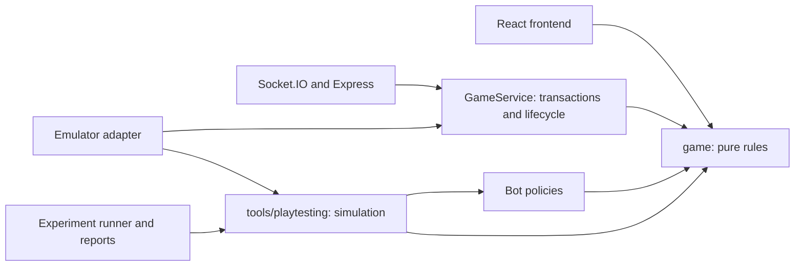

# Relic Rush architecture

This is the source of truth for architectural boundaries. Update this document alongside changes to responsibilities, interfaces, dependencies, or deployment packaging. The older `CLAUDE.md` contains historical guidance; the current README and this document describe the supported application.

See [initial screening findings](tools/playtesting/FINDINGS.md) for the first 2.88-million-match screen, higher relic counts, two-player concerns and suggested confirmation experiments.

## Dependency direction



The application never imports the playtesting harness. Shared rules never import application or harness code. Only the harness's emulator adapter may import the server. A TypeScript AST-based dependency check enforces literal imports, re-exports, dynamic imports, and `require` calls; nonliteral module loading needs explicit architectural review. The harness must not import frontend code.

`game/` is a deliberately small production dependency, not a testing framework. Its plain JavaScript ES modules run in Node and Vite without a server compilation step. Adjacent declarations supply TypeScript interfaces. It contains no I/O, database SDK, randomness, process configuration, or clock access.

## Application and pure rule interfaces

The Node service owns authentication/authorization checks, request validation and deduplication, serialized command handling, Firestore transactions, session recovery, lobby lifecycle, deadlines, archival, and retries. The React application owns presentation, input, connection handling, and subscriptions. Multiple tabs share the authenticated guest identity.

Pure rules accept explicit inputs:

- `resolveDig(player, discoveries, position, {now, deadline, status, score?})` returns a new player and discovery log. The player carries an array board, score, remaining digs, discoveries, accepted moves, and identity. It rejects unavailable squares, invalid coordinates, inactive matches, and moves at or beyond the deadline. Finds refund the dig. Unchanged rows may be shared; adapters must treat returned state as immutable.
- `calculatePoints(order)` implements the production 100/80/60/40/20/0 curve. An optional scoring function supports simulation; the production service always uses the default and exposes no experiment switches.
- `calculateHints(log, playerId, gridSize)` returns unique opposing finds not yet found by this player, grouped into nine regions. Raw discovery coordinates never enter the bot interface.
- `completionReason(players, deadline, now, treasureCount?)` gives deadline precedence, returns `digs-exhausted` when everyone is out of digs, or `players-finished` when every player has either exhausted their digs or discovered all relics. Adapters pass the session’s recorded treasure count; omitting it retains exhaustion-only behaviour. Empty player lists never complete early; `rankPlayers(players)` preserves shared ranks with skipped places.

The server translates persisted JSON boards into arrays, calls the rules inside its existing transaction, and persists the result. It checks duplicate request IDs before calling the rules, including retries after expiry. Frontend helpers re-export shared scoring, hint, and region functions while retaining their existing interfaces. Server layouts still use `node:crypto`; seeded randomness exists only in the harness.

Production matches require at least three players for ready/countdown starts and start automatically at six. New lobbies contain eight cryptographically placed relics, ten starting digs and a 120-second duration. Existing sessions retain their stored layouts, treasure counts and deadlines; the corrected completion check uses each session’s recorded count, including during recovery/maintenance. No schema migration or live rule-selection endpoint is needed. Historical balance reports retain their source snapshots and describe the rules at the time of each run. Docker and Cloud Run upload allowlists include `game/` and `server/`, excluding the harness and reports. Vite only bundles modules reachable from the application.

## Playtesting structure and observation boundary

`tools/playtesting/` has separate responsibilities:

| Module | Responsibility |
|---|---|
| `simulation/` | Seed streams, fixture construction, virtual events, observations, seat rotation, match results |
| `policies/` | Decisions using only sanitized observations and an injected random stream |
| `experiments/` | Settings, scoring alternatives, opponent lineups and timing presets |
| `adapters/` | Local Firebase emulator comparisons against the real GameService |
| `reporting/` | Seed-cluster statistics, paired comparisons, HTML/CSV/JSON output |
| `tests/` | Mechanics, determinism, information isolation, imports, packaging and CLI checks |
| `cli.js` | Run orchestration, source fingerprint, replay and artifact lifecycle |

This supports reuse within Relic Rush. It deliberately avoids a generic multi-game abstraction or dependency injection framework.

A policy accepts `(policyId, observation, random)` and returns a coordinate, an absolute virtual `waitUntil`, or no action. Observations contain only personal revealed cells, score, digs, region hints, standings, elapsed time, and duration. Unrevealed cells omit treasure and discovery-order data. Standings omit boards and precise opposing discoveries. Views and their collections are copied before calling policies. Bots cannot inspect the engine state or log; a test changes hidden layouts while asserting identical observations and decisions.

Explorer chooses uniform squares. Hint follower maximizes hint count divided by unrevealed squares in a region. Hybrids explore with 25%, 50%, or 75% probability and otherwise follow hints. Patient follower waits until 25% of duration, follows hints, and conserves its last two digs until 50%. Ties and exploration use the injected seeded random stream. These are specified behaviours, not learned players or claims of optimal play.

## Virtual time and reproducibility

The simulator has decision, request arrival, acknowledgement, and public update events. Think time starts at match start and after each acknowledgement. `latencyMs` is **one-way** latency: request arrival costs that interval, then acknowledgement and subscription delivery cost another interval. A player can have at most one outstanding move. Update events carry snapshots from commit time; policies use only delivered information. The match deadline wins over any event at the same timestamp, and the match ends immediately when every player exhausts their digs.

The default think interval is 3 seconds; focal players also test 1 and 8 seconds. The default one-way latency is 100 ms; a disadvantaged player tests 500 ms. These are sensitivity assumptions, not measurements of human reaction or real network performance. No wall-clock sleep is used.

FNV-1a-seeded Mulberry32 supplies independent named streams for layout, player-role choices, and event ordering. Layout generation shuffles the 36 cells once, allowing nested treasure-count comparisons. Player-role streams remain stable across seat rotations. Event ordering is seeded independently, with serial order as a final fallback. Layouts and random sequences are reused across conditions to make paired comparisons; policy changes can still consume random draws differently.

Each board seed runs all N seat rotations. Rotations and players from the same board are correlated; statistics average them **before** treating board seeds as independent observations. Win credit is split equally across tied winners. Outright wins are reported separately. Explorer-beats-hybrid means an explorer's score strictly exceeds every hybrid in that match; use it only for explorer rows in mixed groups. Tie rate refers to tied first place. Intervals are approximate 95% normal intervals over seed means and paired differences; bounds are not clipped. Screening has no multiple-comparison correction, so confirmation requires fresh seeds.

Every run records settings, lineups, seeds, rule/bot/engine versions, source revision, dirty status, SHA-256 content fingerprint, and included source files. Replay requires matching source fingerprint and engine version and compares the entire recorded result. Keep the source checkout or snapshot along with reports; a fingerprint alone cannot restore a dirty checkout. Runtime source, harness tests, package manifest and lockfile are fingerprinted. Documentation and generated artifacts are not runtime inputs.

## Experiments and operation

```sh
npm run balance:test
npm run balance -- --preset baseline
npm run balance -- --preset screen
npm run balance -- --preset screen --matches 20 --players 2 --scenario hybrid50-vs-explorer
npm run balance -- --preset confirm --config tools/playtesting/experiments/confirmation.example.json
npm run balance -- --replay .balance-results/<run>/examples/<match>.json
npm run balance:emulators
```

`--matches` means independent board seeds **per condition**, not total matches; all seats rotate for each seed. Baseline and screen default to 1,000 seeds per condition, confirmation to 10,000. Screening uses seeds 1–1,000,000, confirmation starts at 1,000,001; use a different range for each independent confirmation. Confirmation requires an explicit configuration file. The supplied example illustrates combinations and is not a recommendation. A config file is an object or array merging over baseline settings; IDs must be unique, and unknown setting keys fail.

Screening fixes the 6×6 board and treasure dig refund, then changes one variable from five treasures, ten digs, 120 seconds, current scoring: 4/6/8/10 treasures, 8/12 digs, 60/90 seconds, and three scoring alternatives. Gentle declines by 10; player-count scoring linearly declines from 100 to 40 across the match's player count, rounded to integers; first-bonus awards 80 plus 20 to the first finder. No scoring policy changes the production default.

The higher counts include player feedback that five relics may feel sparse. Keep two-player games in the screen as a diagnostic comparison, reporting them separately from four and six players. Two-player simulations remain available as diagnostic controls; production now requires three players.

Scenarios include all six homogeneous policy groups; each different focal policy against explorer and 50%-hybrid backgrounds; equal, fast, slow and disadvantaged-latency hybrid matches. The runner saves traces for the first seed's first rotation of every condition, and full failing input on error. Individual results are aggregated rather than retaining millions of traces.

Outputs default to ignored `.balance-results/<timestamp>/`: standalone `report.html`, `aggregate.csv`, `results.json`, `manifest.json`, and replayable `examples/`. `--output` selects a new directory outside source trees. Existing completed runs are not overwritten. Preserve the entire directory for review, copy a compact findings summary into the repository when useful, and remove disposable smoke-run directories when no longer needed. Runtime requires neither LLM calls nor network access.

Use paired win-credit comparisons rather than raw scores when comparing scoring policies. Check hybrids against both pure strategies, patient against immediate hints, speed/latency effects, zero-find rates, exhausted waiting and deadline frequency. A useful candidate should favour mixed strategy without eliminating explorer upsets. Reports expose tradeoffs and uncertainty; a person nominates settings for fresh-seed confirmation and human testing. Bots do not assess comprehension, enjoyment, learning or fatigue.

To add a policy, implement it in the policy module using only observations, register its ID, add focused behavioural/isolation tests, and increment `BOT_VERSION`. To add a scoring condition, keep it in experiments and add exact-value tests. To add a scenario, specify lineup, stable roles, focal role and timing, then document it. Changes to event semantics increment `ENGINE_VERSION`; changes to shared mechanics increment `RULES_VERSION`. Include new source types in fingerprinting and boundary tests if needed.

## Emulator adapter and verification

Parity checks require both local emulator host variables and always use `demo-relic-rush`. They reset **only that demo database**; never run them alongside a shared emulator session. They do not load `.env` or production credentials. Fixture layouts are written before joining; the production server receives ordinary moves with its normal scoring and clock injection. Explicit equal-time schedules define commit order; existing integration tests separately cover genuinely concurrent commands.

Two- and six-player fixtures compare boards, scores, digs, accepted moves and discovery logs after each move, then compare completion and final ranks. They exercise same-time discoveries, refunds, duplicate acknowledgements, repeated squares, exact deadline expiry, exhaustion and ties. Because both paths share mechanics, independent rule assertions and existing integration tests remain necessary: parity primarily detects mapping, persistence, and lifecycle drift.

Run `npm run typecheck`, `npm run lint`, `npm test`, `npm run balance:test`, `npm run build`, and emulator integration/parity checks after changes to the shared boundary. Existing browser tests continue checking actual UI behaviour; browser bots are a future adapter rather than a simulator dependency.

CI runs the harness and boundary tests with the existing unit/build checks, then runs integration, parity and browser tests sequentially inside one isolated emulator session. The full balance screen remains an explicit local experiment rather than a requirement for every commit. On systems where localhost resolves to IPv6, use `NODE_OPTIONS=--dns-result-order=ipv4first` when invoking browser tests against the configured IPv4 URL. An existing Chrome executable can be selected through `PLAYWRIGHT_CHROMIUM_EXECUTABLE` if the matching Playwright browser is not installed.

## Adversarial suite and frozen tactic tuning

The classic suite remains available with its original six policies and parameter screen. `--suite adversarial` tests 3, 4, 5 and 6 players, 8/10 relics, and current/player-count-adjusted scoring: four rule configurations and 31 scenarios per count. `--players` accepts any subset of 2–6, and `--scenario` accepts comma-separated exact IDs for targeted confirmation.

Five additional policies use only sanitized observations and public settings:

- **Probability hunter:** computes region occupancy probabilities by exact combinatorial convolution over layouts consistent with personal reveals, the total remaining relics and hint lower bounds. It assumes uniform layouts within those constraints; it does not infer opponent selection bias or see discovery coordinates. Cached results are immutable and cache eviction cannot change decisions.
- **Opportunist:** conserves digs until opponents have spent a chosen fraction of their miss allowance and useful hints exist. It starts by a conservative latest-start time even when everyone waits.
- **Adaptive racer:** uses one-second thinking while hinted regions are insufficiently dense or every opponent is exhausted; otherwise it uses the scenario's base thinking interval. The selected next thinking interval takes effect after acknowledgement.
- **Leader:** polls every three seconds while its visible score leads every opponent by more than a selected buffer. It resumes if that lead disappears, exposing whether information withholding pays.
- **Late sprinter:** waits until the deadline minus a worst-case action budget and a selected safety reserve, then uses one-second thinking. The budget includes remaining misses, every remaining relic, round-trip latency and an extra second.

All five stop digging when their visible finds account for the full known relic count. This deliberately tests the real completion rule: collecting every relic does not currently end a player's hunt or the match. The simulator preserves that rule, so rational stopping can force the match to wait for its deadline. It does not spend pointless digs to conceal this behaviour.

Engine v2 adds public rule/timing fields to observations, specified per-action thinking intervals, monotonic commit revisions on delivered hint/standings updates, and first-dig, deliberate-wait and longest-quiet-period metrics. The quiet period includes start/end inactivity and measures gaps between accepted digs. It also reports zero scores and win credit relative to the fair share of 1/N. Production modules and rules are unchanged by this suite.

The scenario population includes homogeneous reference/adaptive groups, each new tactic invading hybrid opponents, all eleven policies invading a common adaptive background, three heterogeneous fields, and constant one-/three-/eight-second probability controls plus disadvantaged latency. A tactic is assessed against other tactics as well as cooperative explorers; homogeneous waiting fields expose uninteresting coordination outcomes.

Tune before evaluating:

```sh
npm run balance -- --preset tune --output .balance-results/tuning
npm run balance -- --suite adversarial --preset screen --tactics .balance-results/tuning/tactics.lock.json
```

Tuning defaults to 64 training seeds starting at 20,001, all four configurations, all four player counts, all seat rotations and two backgrounds (hybrids and a cycling mix of hint/probability/hybrid/explorer/patient). It tests opportunist spent fractions 0.25/0.5/0.75, racer density thresholds 0.25/0.5/0.75, leader buffers 0/40/100 points, and sprinter reserves 0/10/20 seconds. The probability policy has no tuned parameter. It maximizes focal mean win credit divided by 1/N, weighting configurations/counts/backgrounds equally after averaging rotations. Ties choose the first listed parameter. Training confidence intervals are descriptive and selection is not evidence of superiority.

`tactics.lock.json` records selected parameters, all candidate scores, training seeds, settings, engine/bot versions and source fingerprint. Screening defaults to seeds starting at 40,001, and refuses any overlap with training seeds. Adversarial confirmation requires both an explicit config file and the frozen tactic lock, uses seeds above 1,000,000, and defaults to 10,000 seeds. Lock files must match the source fingerprint/bot version; evaluate changed policies by retraining and recording a new lock, not silently reusing old results.

Every new run copies its fingerprinted source inputs into `source/`, excluding credentials and generated artifacts. The original screen also has a verified source snapshot. Restore a saved source snapshot in an isolated checkout to replay an older engine without overwriting current work. Reports can be rendered from aggregate summaries through the reporting module independently of simulation; source provenance and per-count paired comparisons must remain intact when combining independent player-count partitions.
